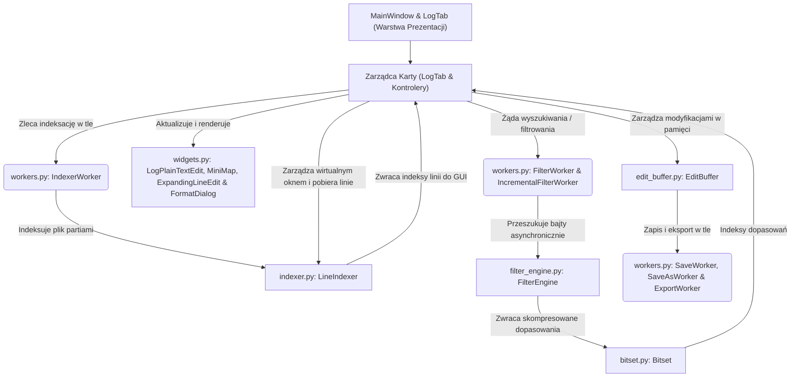

# Architektura Systemu i Przepływ Danych (Data Flow)

Dokument ten opisuje architekturę techniczną aplikacji **Log Viewer**, podział odpowiedzialności między poszczególnymi modułami oraz sposób, w jaki dane przepływają przez system w krytycznych ścieżkach wydajnościowych.

## 1. Wysokopoziomowy Diagram Komponentów

Poniższy diagram ilustruje, w jaki sposób komponenty wewnątrz pakietu współdziałają ze sobą podczas procesu otwierania, indeksowania, filtrowania, edycji i wyświetlania dużego pliku.

---

## 2. Podział Odpowiedzialności Modułów

### 1. `main_window.py`
Punkt wejścia interfejsu graficznego. Odpowiada za:
* Główne okno aplikacji (`MainWindow`), menu górne, pasek narzędzi oraz pasek stanu.
* Zarządzanie kartami (`QTabWidget`), w tym dodawanie, zamykanie, przenoszenie kart oraz obsługę zdarzeń upuszczania plików (Drag & Drop) na poziomie całego okna.
* Globalne skróty klawiszowe i wywoływanie akcji dotyczących całej aplikacji (np. otwieranie plików, przełączanie motywu, okno ustawień).

### 2. `log_tab.py` i podkatalog `controllers/`
Reprezentuje pojedynczą kartę z otwartym plikiem logu. Moduł został zdekomponowany na wyspecjalizowane kontrolery w celu zachowania zasady pojedynczej odpowiedzialności (SRP):
* `FileController` – zarządza wczytywaniem, indeksowaniem, przeładowywaniem plików oraz śledzeniem zmian w trybie na żywo (*Tail / Follow Mode*).
* `EditController` – nadzoruje edycję tekstu wewnątrz wirtualnego widoku, wywoływanie okna formatowania (`FormatDialog`), operacje dialogowe zapisu oraz eksport zmian.
* `SearchController` – koordynuje proces wyszukiwania fraz i wyrażeń w pliku oraz w przefiltrowanych wynikach.
* `FilterController` – steruje filtrowaniem zawartości z uwzględnieniem dodatkowych opcji (jak linie kontekstu, negacja, wyrażenia regularne).
* `BookmarkController` – zarządza zakładkami (*bookmarks*) w obrębie otwartego pliku oraz ich usuwaniem i nawigacją.
* `ViewportController` – zarządza wirtualnym oknem (*viewport*), leniwym doładowywaniem wierszy z krawędzi (`append_lines`, `prepend_lines`), pobieraniem pełnej (nieuciętej przez widok) treści linii z bufora lub `LineIndexer`, nawigacją (`cmd_goto`, skok do linii i do offsetu bajtowego) oraz zaznaczeniami podświetleń (`ExtraSelections`, w tym podświetlaniem dokładnych dopasowań podciągów w aktywnej linii wyszukiwania i automatycznym przewijaniem poziomym do trafienia).
* `UIController` – zarządza elementami interfejsu karty, połączeniami sygnałów i slotów (drzewa zakładek i edycji, widok wyników wyszukiwania `search_results_view`), dynamiczną aplikacją motywów (Dark/Light), czcionek oraz synchronizacją wskaźnika minimapy.

Klasa główna `LogTab` spina ze sobą te kontrolery, zachowując zwięzłość kodu i spójność stanu w karcie.

### 3. `indexer.py`
Stanowi jądro mechanizmu pozwalającego obsłużyć ogromne pliki. Moduł wykorzystuje paczkę `multiprocessing` oraz metody rzadkiego indeksowania w celu minimalizowania obciążenia pamięci.
* Zawiera klasę `LineIndexer`, która analizuje plik w dużych częściach (zoptymalizowanymi chunkami 32 MB), ustalając relacje liczby linii w stosunku do przesunięć bajtów w pliku (`IndexEntry`). Dla dużych plików indeksowanie wykonuje się wielowątkowo przy użyciu pamięci współdzielonej (`multiprocessing.sharedctypes`), a odczyty z indeksu są optymalizowane przez sekwencyjne proxy dla modułu `bisect`.
* **Gęstszy indeks (16 KB)**: Domyślny odstęp punktów indeksu wynosi `16 KB` (`INDEX_INTERVAL_BYTES = 16 * 1024`), co zapewnia ~9× szybszy swobodny dostęp i skoki do linii (w widoku po filtrze, wirtualnej liście wyników i suwaku) przy minimalnym narzucie pamięciowym (~10.5 MB RAM dla pliku 10 GB). Bufory I/O odczytu swobodnego (`_get_file`) oraz wyszukiwania znaku nowej linii (`line_at_byte_offset`) są precyzyjnie dostrojone do 64 KB.

### 4. `filter_engine.py`
Niskopoziomowy silnik wyszukiwania i filtrowania danych realizowany w osobnym wątku.
* Klasa `FilterEngine` przetwarza surowe bajty zamiast bezpośrednio wczytywać napisy typu String (strategie `PlainTextStrategy` i `RegexStrategy`). Skutkuje to ogromnym wzrostem wydajności dla wyszukiwania i odfiltrowania danych dla określonych wzorców. Silnik zwraca wysoce skompresowany obiekt `Bitset` zamiast standardowych list, redukując użycie pamięci i przyspieszając operacje binarne na milionach dopasowań.
* **Wsparcie Unicode dla wyszukiwania bez rozróżniania wielkości liter (`case_sensitive=False`)**:
  - Dla fraz ASCII (`needle.isascii()`) zachowana jest bezalokacyjna ścieżka C na surowych bajtach (`chunk.find(needle_bytes)`).
  - Dla fraz ze znakami non-ASCII (np. `BŁĄD` ↔ `błąd`) budowany jest prekompilowany wzorzec alternatyw bajtowych (`_unicode_matcher`), co pozwala przeszukiwać wielomegabajtowe bloki bezpośrednio na bajtach bez kosztownego dekodowania do `str`.
  - W `RegexStrategy` dla zapytań regex z flagą `case_sensitive=False` i znakami spoza ASCII silnik korzysta z pełnych reguł Unicode Pythona poprzez zoptymalizowaną metodę `_match_chunk_str`.

### 5. `bitset.py`
Samodzielny fundament wydajnościowy aplikacji, operujący bezpośrednio na tablicach słów maszynowych `array.array('Q')`:
* Przechowuje miliony trafień w skompresowanej strukturze bitowej, redukując zużycie pamięci operacyjnej do ułamka megabajta.
* Oferuje zoptymalizowane zliczanie unikalnych dopasowań w C (`itertools.accumulate` oraz `int.bit_count`) i leniwe buforowanie długości.
* Zawiera autorskie, szybkie implementacje wyszukiwania binarnego (`bisect_left_custom`, `bisect_right_custom`) operujące bezpośrednio na bitach bez konieczności rozpakowywania ich do list Pythona.

### 6. `edit_buffer.py`
Zarządza stanem modyfikacji tekstu bez naruszania oryginalnego pliku źródłowego:
* Wykorzystuje strukturę `BTreeMap` (ze słownikiem jako fallback) do przechowywania i szybkiego wyszukiwania nadpisanych linii logu.
* Posiada wewnętrzny rejestr przesunięć (`_LineShiftManager`), który przelicza numery wierszy w czasie rzeczywistym podczas wstawiania lub usuwania linii w edytorze.
* Izoluje zmiany w pamięci do momentu świadomego zapisu przez użytkownika.

### 7. `formatters.py` i `highlighters.py`
Odpowiadają za parsowanie, bezpieczną analizę i prezentację ustrukturyzowanych danych:
* `formatters.py` – zawiera bezpieczne formatery JSON oraz XML oparte o `defusedxml.minidom`. Automatycznie wykrywa i formatuje pojedyncze oraz wielokrotne struktury osadzone w linii logu (np. `Request: {...} Response: {...}`), chroniąc przed atakami parsowania XML (XML entity expansion) oraz zabezpieczając przed zawieszeniem GUI na gigantycznych ciągach za pomocą twardych limitów długości wejścia i liczby struktur.
* `highlighters.py` – definiuje klasę `StructuredCodeHighlighter` opartą na `QSyntaxHighlighter`, która zapewnia kolorowanie składni JSON i XML w oknie formatowania (`FormatDialog`). Klasa zawiera bezpieczniki wydajnościowe (limit długości bloku 10 000 znaków, wyłączenie podświetlania dla dokumentów powyżej 500 000 znaków), eliminując ryzyko przycięcia interfejsu przy olbrzymich strukturach.

### 8. `workers.py`
Definiuje zestaw asynchronicznych wątków robotniczych (`QThread`), które odciążają wątek główny GUI:
* `IndexerWorker` – emituje zdarzenia w miarę postępu tworzenia mapowania offsetów indeksu z `LineIndexer`.
* `FilterWorker` – spina działania `FilterEngine` wywołując asynchroniczne postępy wyszukiwania oraz agreguje finalny obiekt `Bitset` dla modelu.
* `IncrementalFilterWorker` – wyspecjalizowany wątek powiązany z trybem "Follow/Tail Mode", skanujący na bieżąco (inkrementalnie) i zwracający trafienia z nowo dodanych części logu.
* `SaveWorker` – obsługuje tło zapisu zawartości po wniesieniu edycji na poszczególnych linijkach.
* `SaveAsWorker` – obsługuje zapis zmodyfikowanej zawartości do nowego pliku asynchronicznie.
* `ExportWorker` – obsługuje eksport wyników filtrowania i zaznaczeń do osobnego pliku.

### 9. `widgets.py`
Definiuje wyspecjalizowane, wizualne komponenty widoku dla biblioteki PySide6:
* `LogPlainTextEdit` – autorski widżet poszerzający bazowy `QPlainTextEdit` o wsparcie do pracy ze zdarzeniami `Drag & Drop`, numeracją wierszy, skrótami formatowania/kopiowania pełnych linii oraz malowaniem kontekstowego podświetlenia dla bieżącej linii.
* `MiniMap` – maluje na kanwie pionową mapę wskaźnika pozycji i widocznego obszaru w oparciu o całkowitą liczbę wierszy, oferując błyskawiczną nawigację.
* `SearchResultsModel` – model danych oparty na `QAbstractListModel`, optymalizujący listę setek tysięcy rezultatów bez obciążania i zawieszania aplikacji za pomocą leniwego pobierania elementów w miarę scrollowania (`fetchMore()`). Jako źródło prawdy przyjmuje strukturę `Bitset`.
* `ExpandingLineEdit` – zaawansowane pole wyszukiwania z pływającą nakładką wielowierszową (*floating overlay*), automatycznym rozszerzaniem widoku dla długich zapytań, historią wyrażeń i wsparciem skrótów klawiszowych, działające bez deformowania layoutu kontrolek rodzica.
* `FormatDialog` – okno dialogowe do formatowania i analizy struktur JSON/XML (pobierające pełne, nieucięte linie z pliku), wyposażone w kolorowanie składni (`StructuredCodeHighlighter`), wbudowaną wyszukiwarkę wewnętrzną (`Ctrl+F`, `F3`/`Shift+F3`, licznik trafień, dwustopniowy `Escape`), przełącznik zawijania wierszy (`Word Wrap`), kopiowanie do schowka oraz nawigację między sąsiednimi liniami logu.
* Oraz dodatkowe komponenty (takie jak `LineNumberArea`, `SettingsDialog`), które odpowiadają za detale wizualne i ustawienia aplikacji.

### 10. Moduły wspierające: `config.py`, `i18n.py`, `helpers.py`
* `config.py` – zarządza trwałą konfiguracją użytkownika (`UserConfig`) zapisaną w pliku JSON w katalogu domowym (`~/.log-viewer.json`), z automatyczną migracją parametrów (np. `index_interval_bytes`).
* `i18n.py` – centralne repozytorium tłumaczeń interfejsu aplikacji, wspierające przełączanie w locie pomiędzy językiem polskim i angielskim.
* `helpers.py` – zawiera stałe systemowe, definicje palet stylów motywów (`THEME_DARK`, `THEME_LIGHT`, w tym kolory podświetleń wyszukiwania i składni JSON/XML), obsługę przezroczystego odczytu plików skompresowanych (`open_maybe_compressed` dla `.gz`, `.bz2`, `.xz`), skracanie zbyt długich linii (`truncate_for_display`) oraz parser zdarzeń przeciągania plików (Drag & Drop).
